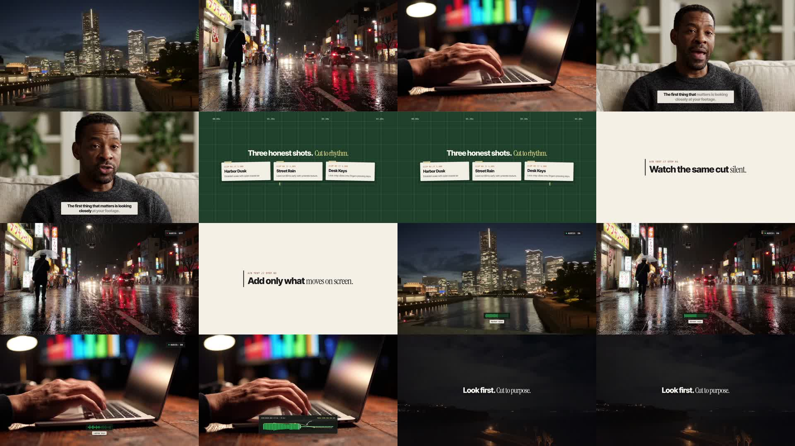
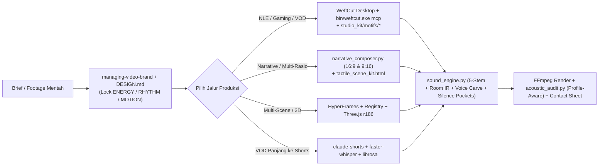

# Agyditor (AGY Local Video Studio)

Studio penyuntingan dan pembuatan video *open-source* berbasis lokal (`Option A`) yang berjalan penuh di workstation Windows dengan akselerasi GPU Chromium dan FFmpeg. Repositori ini menyatukan **WeftCut** via MCP, mesin *motion graphics* **OneTake**, komposisi HTML/GSAP/Three.js **HyperFrames**, serta pemotongan klip **Claude Shorts**. Semua alur bergantung pada pustaka gerak lokal di `studio_kit/` tanpa layanan berbayar seperti InVideo atau ElevenLabs.



> Contact sheet 16 frame ini diambil dari [narrative_cinema_16x9.mp4](studio_kit/renders/narrative_cinema_16x9.mp4) (`1920x1080`, `30 fps`, `22,8 detik`) dan [narrative_shorts_9x16.mp4](studio_kit/renders/narrative_shorts_9x16.mp4) (`1080x1920`, `30 fps`, `22,8 detik`). Kedua format lahir dari satu pipeline bersama (`-16,3 LUFS`, Peak `-5,7 dBFS`, `mud 44,39%`, pita vokal `39,96%`, `detail+air 10,36%`, variasi shot `CV 0,577`). Hasil itu turut melengkapi showcase primitif [baseline_showcase.mp4](studio_kit/renders/baseline_showcase.mp4) serta [showcase_v2_depth_optics.mp4](studio_kit/renders/showcase_v2_depth_optics.mp4).

---

## Mengapa Arsitektur Ini Dibangun

Banyak templat animasi berbasis web tampak kaku saat dirender menjadi video karena empat hal teknis. Pertama, font sistem seperti `Segoe UI` muncul diam-diam saat font web gagal dimuat. Kedua, satu blok teks DOM kerap digeser bersamaan tanpa buram gerak (*shutter blur*). Selain itu, efek suara sering dipasang acak di atas gambar 3D abstrak atau kisi neon gelap yang tidak membawa cerita. Ketiga, elemen halaman web seperti bilah navigasi atau tombol pemutar ikut terbawa masuk ke kanvas video. Keempat, proyek jarang memisahkan kurva bicara hangat dan padat SFX saat mengaudit spektrum suara.

Agyditor membereskan akar masalah tersebut dari level aturan studio ([GEMINI.md](GEMINI.md)), arahan visual taktil ([DESIGN.md](DESIGN.md)), hingga pipeline dua rasio di `studio_kit/`:

* **Default Visual Taktil & Rekaman Nyata**: Mengutamakan rekaman kamera asli, kertas kraft (`#F4EFE6`), dan papan potong hijau (`#1B3B2B`). Bilah gelombang NLE nyata menggantikan kisi neon gelap atau objek poligon hampa.
* **Self-Hosted Fonts Terbundel**: Seluruh font lokal (`.woff2` dan `.ttf`) dimuat eksplisit melalui `@font-face` dan `await document.fonts.load(...)` sebelum frame ke-0 direkam.
* **Tipografi Mixed-Voice, Kamera 35mm, & Shader GLSL**: Kata kunci tebal (`Inter Tight` tracking `-0.04em`) dipasangkan dengan aksen miring (`Instrument Serif` atau `Fraunces` lewat `font-size-adjust: from-font`). Telemetri `JetBrains Mono`, rig `keyframe_rig.js`, dan shader `Three.js r186` di `optical_stage.js` berjalan seirama.
* **Gerak per Huruf & Shutter Blur 180 sampai 360 Derajat**: Teks dipecah ke tingkat glif atau kolom reel mekanis dengan integral *sub-frame linear-light* atau filter SVG `feGaussianBlur` terarah.
* **Tata Suara 5-Stem & Gerbang Kausal Zero-Waste**: Mesin `studio_kit/sound_engine.py` memadukan `voice`, `ambience` (*room-tone*), `foley` bersumber nyata, `transitions` 3-lapis (*J-cut pre-lap*), dan `music` berukiran vokal plus ekor konvolusi *Great Hall* (`T60 = 2,6 detik`). Rencana visual wajib melewati `beat_sheet.py` (`visual_subject` dan `visual_cause` konkret), sedangkan MP4 akhir diaudit oleh `acoustic_audit.py` sesuai profil `narrative_voice_film` atau `mograph_sfx`.
* **Bebas Krom Web**: Kanvas video dan Motif WeftCut dilarang memuat `<header>`, `<nav>`, tombol klik, atau kotak dialog web.

---

## Arsitektur Pipeline & Stack Lokal (Option A)



### Komponen Utama Repositori

| Direktori / Berkas | Fungsi Utama | Status di Git |
|---|---|---|
| [GEMINI.md](GEMINI.md) | Aturan keras *Option A*, batas hardware Ryzen 5 5500 / GTX 1650, kontrak anti-slop, dan standar v3 tata suara | Terlacak |
| [DESIGN.md](DESIGN.md) | Baseline visual & audio, dial bawaan (`ENERGY 2 / RHYTHM 3 / MOTION 3`), palet warna, dan pemetaan profil | Terlacak |
| [studio_kit/motion_primitives.js](studio_kit/motion_primitives.js) | Pustaka fungsi murni `f(t)` untuk kurva bezier, pegas tertutup, 4 teknik transisi, dan gerak teks | Terlacak |
| [studio_kit/keyframe_rig.js](studio_kit/keyframe_rig.js) & [studio_kit/optical_stage.js](studio_kit/optical_stage.js) | Rig kamera `35mm` DoF, *Dolly Zoom*, kurva *AE Whip*, shader GLSL *MotionTile/RadialMatch/FlashStrobe*, dan vektor nib | Terlacak |
| [studio_kit/occlusion_cutout.py](studio_kit/occlusion_cutout.py) | Oklusi subjek dua tingkat (*Smart Two-Tier Occlusion*) lokal via `rembg` / Chrome | Terlacak |
| [studio_kit/context_router.py](studio_kit/context_router.py) & [studio_kit/color_grade.py](studio_kit/color_grade.py) | Pemilihan gaya otomatis sesuai konteks (`cinematic-essay`, `podcast-collage-short`, `creator-editorial`, `kinetic-reel-typography`) serta generator 3D LUT `.cube` (*HSV Ch-2 Density* + *Halation* sebelum overlay) | Terlacak |
| [studio_kit/sound_engine.py](studio_kit/sound_engine.py) & [studio_kit/sound_palette_index.json](studio_kit/sound_palette_index.json) | Mesin 5-stem (`voice`, `ambience`, `foley`, `transitions`, `music`), konvolusi *room* & *Great Hall*, deteksi nada lagu otomatis (`librosa`), sapuan EQ LP/HP, serta indeks `173` aset lokal (termasuk `24` *Multiply Sound Tonal SFX*) | Terlacak |
| [studio_kit/beat_sheet.py](studio_kit/beat_sheet.py) & [studio_kit/acoustic_audit.py](studio_kit/acoustic_audit.py) | Gerbang pra-render *zero-waste*, *Flow-of-Motion*, disiplin transisi, serta audit spektral 4 profil (`cinematic_essay`, `podcast_collage_short`, `narrative_voice_film`, `mograph_sfx`) | Terlacak |
| [studio_kit/motifs/](studio_kit/motifs/) | Enam WeftCut Motif mandiri beserta manifest, font lokal `./fonts/`, bundle Three.js luring, dan primitifnya | Terlacak |
| [studio_kit/fonts/](studio_kit/fonts/) & [studio_kit/sfx/](studio_kit/sfx/) | Font offline OFL/TTF, efek suara CC0, dan folder lokal `tonal_pack/` (`24` WAV tonal bebas hak cipta) | Terlacak |
| [studio_kit/narrative_composer.py](studio_kit/narrative_composer.py) & [studio_kit/tactile_scene_kit.html](studio_kit/tactile_scene_kit.html) | Pipeline multi-rasio (`16:9` dan `9:16`), hamparan papan potong taktil, layout *Luda Letterbox*, kartu kolase *marksoy*, *Split-S-Curve*, tiga mesin tipografi naratif (`narrative_cluster`, `camera_2d_canvas`, `explainer_visual_diagram`), serta lencana gelombang stereo NLE | Terlacak |
| [studio_kit/safe_zones.py](studio_kit/safe_zones.py) | Penjaga zona aman UI lintas platform (`universal_vertical` aman `30%` bawah dan `17%` kanan, `youtube_16x9`), audit otomatis kotak DOM Playwright, dan *ghost UI* bukti visual | Terlacak |
| [references/](references/) | Kajian teknis transisi v1/v2, optik 3D ([DEPTH_OPTICS_ARCHITECTURE.md](references/depth_optical_study/DEPTH_OPTICS_ARCHITECTURE.md)), tata suara ([SOUND_CINEMA_ARCHITECTURE.md](references/sound_cinematography_study/SOUND_CINEMA_ARCHITECTURE.md)), editorial v4 ([EDITORIAL_CLASSUP_GUIDE.md](references/editorial_classup_study/EDITORIAL_CLASSUP_GUIDE.md)), serta tipografi naratif & zona aman v5 ([NARRATIVE_TYPOGRAPHY_SAFEZONE_GUIDE.md](references/narrative_typography_study/NARRATIVE_TYPOGRAPHY_SAFEZONE_GUIDE.md)) | Terlacak |
| `.agents/skills/` | Paket skill penuh (`driving-weftcut`, `editing-gaming-clips`, `managing-video-brand`, `onetake`, `hyperframes*`, `ffmpeg-skill`, `claude-shorts`, `sound-effects`, `explainer-*`, `threejs-*`, `ghost-editor`, `motion-video-director`) | Terlacak |
| [tests/test_option_a_stack.py](tests/test_option_a_stack.py) | Suite `pytest` yang memvalidasi biner, modul Node, kontrak 6 Motif, 5-stem audio/carving, anti-slop, dan render v1/v2/v3 | Terlacak |
| `bin/*.exe` & `tools/WeftCut/` | Biner lokal (`ffmpeg.exe`, `ffprobe.exe`, `yt-dlp.exe`, `weftcut.exe`) dan aplikasi desktop WeftCut | Diabaikan (`.gitignore`) |

---

## Katalog Primitif Teks, Transisi, dan Starter Motifs

Seluruh rumus animasi pada `studio_kit/motion_primitives.js` berjalan sebagai fungsi murni terhadap waktu detik `t` (`window.AGYMotion` di browser atau `require('./studio_kit/motion_primitives.js')` di Node). Desain ini membuat timeline dapat ditarik maju atau mundur di frame mana pun tanpa meleset.

### 1. Enam Starter WeftCut Motifs

Keenam Motif ini memakai kontrak resmi `motif.define({ setup, frame })`, menyematkan font lokal di `./fonts/`, dan siap diimpor ke WeftCut:

* **`apple-follower-reveal`** (`studio_kit/motifs/apple-follower-reveal/`): Reveal per huruf dari kiri ke kanan dengan jeda ketat dan perpindahan Y `-0.3em` tanpa pantulan (*Out Cubic*). Huruf bergerak dari buram `6px` menuju `0px` sambil membawa bayangan masing-masing.
* **`ghost-echo-kinetic`** (`studio_kit/motifs/ghost-echo-kinetic/`): Transisi dua lapis antara dua frasa pada waktu `cue_swap_s` menggunakan kurva `cubic-bezier(0.38, 0, 0, 1)`. Frasa lama memudar sebagai eko residu `20%` yang membesar dan memburam keluar saat kata baru masuk.
* **`rolling-cylinder-slot`** (`studio_kit/motifs/rolling-cylinder-slot/`): Kolom guliran vertikal terpotong `overflow: hidden` memakai SVG `feGaussianBlur` terarah pada sumbu Y. Blur mengikuti puncak kecepatan guliran, lalu mengunci tajam dengan warna aksen terpisah.
* **`kinetic-3d-spatial`** (`studio_kit/motifs/kinetic-3d-spatial/`): Komposisi vertikal tiga bidang Z yang digerakkan fokus kamera (*Depth-of-Field lens blur*). Tipografinya memadukan `Inter Tight`, `Instrument Serif` miring, dan `JetBrains Mono`.
* **`cylinder-3d-orbit`** (`studio_kit/motifs/cylinder-3d-orbit/`): Teks ekstrusi Three.js `r186` beserta pita silinder berputar dan `SpotLight` dengan bayangan siap sisip di belakang subjek.
* **`signature-glow-trim`** (`studio_kit/motifs/signature-glow-trim/`): Animasi *Trim-Path* per glif vektor memakai `Instrument Serif` beserta titik cahaya nib berpendar.

### 2. Empat Primitif Transisi Studi

* **`foregroundOcclusionWipe`**: Sapuan 3-lapis berdurasi 12 sampai 18 frame (30 fps) memakai poligon oklusi miring.
* **`cutoutFrameHoldSlide`**: Subjek terisolasi meluncur masuk 5 sampai 8 frame duluan memakai shutter blur 180 derajat sebelum klip baru berjalan.
* **`smoothMaskReveal`**: Sapuan mask melengkung berkecepatan puncak di titik 50% memakai kurva `[0.7, 0, 0.3, 1]` dan dorongan skala `1.00 -> 1.05`.
* **`angledSplitZoom`**: Garis potong diagonal ber-feather lembut dengan counter-zoom berlawanan arah (`1.00 -> 1.06` keluar, `1.08 -> 1.00` masuk).

---

## Alur Penggunaan (Workflow Harian)

### Tahap 0: Persiapan Lingkungan Lokal (Sekali Setelah Clone)

Repositori sengaja mengecualikan file executable berat (`bin/*.exe`, `tools/`, `node_modules/`). Setelah melakukan `git clone`, siapkan lingkungan kerja di drive target (disarankan `D:`). Langkah ini menjaga cache Chromium dan render agar tidak membebani drive sistem:

1. **Pasang dependensi Node dan Python 3.11**:
   ```powershell
   npm install
   pip install numpy scipy pillow matplotlib fonttools brotli opencv-python playwright faster-whisper librosa pytest
   ```
2. **Sediakan biner lokal di `bin/` dan `tools/WeftCut/`**:
   * Unduh FFmpeg 6.1+ (atau 8.x), `yt-dlp.exe`, dan rilis Windows **WeftCut**.
   * Simpan executable tersebut ke `bin/ffmpeg.exe`, `bin/ffprobe.exe`, `bin/yt-dlp.exe`, dan `bin/weftcut.exe`. Taruh juga aplikasi desktopnya di `tools/WeftCut/WeftCut.exe`.
3. **Set environment variable FFmpeg agar HyperFrames tidak mencari jalur sistem kosong**:
   ```powershell
   $env:PATH = "$PWD\bin;$env:PATH"
   $env:HYPERFRAMES_FFMPEG_PATH = "$PWD\bin\ffmpeg.exe"
   $env:HYPERFRAMES_FFPROBE_PATH = "$PWD\bin\ffprobe.exe"
   ```
4. **Daftarkan MCP WeftCut** (bila memakai asisten AI seperti Antigravity atau Claude):
   ```powershell
   .\bin\weftcut.exe print-config
   ```
   Salin blok `mcpServers` tersebut ke konfigurasi MCP klien Anda (`~/.gemini/config/mcp_config.json`).

---

### Alur 1: Edit Footage, Klip Gaming, atau Talking-Head di WeftCut MCP

Gunakan profil **`gaming-montage`** (`ENERGY 3 / RHYTHM 3 / MOTION 3`), **`gaming-comedic`** (`ENERGY 3 / RHYTHM 3 / MOTION 2`), atau **`talking-head-reel`** (`ENERGY 2 / RHYTHM 3 / MOTION 2`):

1. **Buka sesi & hubungkan NLE**: Pastikan `tools/WeftCut/WeftCut.exe` berjalan, lalu panggil `weftcut_status` dan `begin_agent_session` untuk mengunci histori edit agar diff timeline dapat ditinjau ulang.
2. **Analisis audio terlebih dahulu (*audio-first*)**:
   * Ekstrak audio dan jalankan `faster-whisper` (`int8` atau `float16`) untuk mendapatkan timestamp per kata.
   * Deteksi *dead air* memakai `detect_pauses`, lalu periksa agar jeda terpotong tidak memakan suku kata pembicara (turunkan `threshold_db` ke `-44` bila perlu).
   * Untuk montase musik (gaya Faide), jalankan analisis onset/beat dengan `librosa` sebelum memotong video.
3. **Potong, atur BGM, dan tempatkan SFX**:
   * Eksekusi `remove_pauses`, `split_layer`, `trim_layer`, atau speed-ramp yang sejajar ke ketukan.
   * Terapkan pemutusan BGM mendadak (`0.15s` hingga `0.5s` sebelum *punchline*) dan letakkan hit suara dari `studio_kit/sfx/` ke trek role SFX.
4. **Pasang Motif & cek visual**:
   * Impor folder Motif dari `studio_kit/motifs/` sebagai overlay di atas trek footage.
   * Jalankan `check_composition` lalu tinjau sampel frame di `Changes` / `Tacks` sebelum ekspor MP4.

---

### Alur 2: Komposisi Naratif Multi-Rasio & Mograph (`studio_kit/` + OneTake)

Cocok untuk film penjelasan naratif, pembuktian A/B suara, maupun video produk dalam orientasi lanskap `16:9` (`1920x1080`) dan vertikal `9:16` (`1080x1920`):

1. Susun rencana adegan konkret dan penyebab bunyinya di berkas JSON seperti `studio_kit/narrative_showcase_beat_sheet.json`, lalu validasi prasyarat zero-waste lewat `studio_kit/beat_sheet.py`.
2. Render satu atau dua rasio sekaligus memakai Chrome GPU (`ANGLE D3D11`), komposisi overlay papan potong + lencana gelombang NLE, 5-stem audio, serta audit pasca-render otomatis:
   ```powershell
   python studio_kit/narrative_composer.py --beat-sheet studio_kit/narrative_showcase_beat_sheet.json --aspects 16x9,9x16
   ```
   Untuk uji primitif gerak cepat berbasis `showcase_v1` tetap tersedia `python studio_kit/render_showcase.py --audio-only`.
3. Periksa contact sheet hasil ([narrative_cinema_16x9_sheet.jpg](studio_kit/renders/narrative_cinema_16x9_sheet.jpg) dan [narrative_shorts_9x16_sheet.jpg](studio_kit/renders/narrative_shorts_9x16_sheet.jpg)) beserta grafik dinamikanya sebelum ekspor final.

---

### Alur 3: Komposisi Multi-Scene & 3D WebGL (`HyperFrames` + `Three.js r186`)

Gunakan profil **`mograph-pro`** untuk penjelasan produk interaktif atau visual 3D:

1. Pastikan dokter CLI lulus pemeriksaan FFmpeg dan Chrome sistem:
   ```powershell
   npx hyperframes doctor --json
   ```
2. Gunakan blok siap pakai dari `hyperframes-registry` (`npx hyperframes catalog`) seperti `motion-blur`, `slot-machine-roll`, `per-word-rise`, atau `text-match-cut`. Untuk gerakan huruf cepat, aktifkan `data-motion-blur="on"` dan `data-motion-blur-shutter="360"`.
3. Untuk objek 3D WebGL/WebGPU/TSL, ikuti aturan skill `.agents/skills/threejs-*` (target `three@0.186`). Di Workstation GTX 1650 (4 GB VRAM), jalankan Playwright Chromium memakai `channel="chrome"` dengan argumen GPU `ANGLE D3D11` (`--use-gl=angle`, `--use-angle=d3d11`, `--enable-webgl`, `--ignore-gpu-blocklist`).

---

### Alur 4: Ubah Video Panjang (VOD) Menjadi Shorts (`claude-shorts`)

Untuk memotong rekaman siaran langsung atau podcast menjadi klip vertikal (`1080x1920`), ikuti urutan berikut:

1. Jalankan transkrip `faster-whisper` untuk memetakan segmen menarik dan hindari pemotongan di tengah kata (*boundary snapping* lewat `claude-shorts`).
2. Bila memakai teknik teks di belakang subjek (`object-separation`), batasi durasinya hanya 1 sampai 3 detik pada pembuka (*hook*) jika PyTorch berjalan di CPU.
3. Ganti takarir blok biasa dengan `apple-follower-reveal` atau `ghost-echo-kinetic`. Cara ini menjaga kalimat tetap terbaca jelas tanpa menutupi wajah pembicara.

---

## Verifikasi & Quality Gate

Setiap perubahan konfigurasi studio, Motif, atau aset baru dapat divalidasi langsung dalam satu perintah:

```powershell
python -m pytest tests/test_option_a_stack.py -v
```

Suite pengujian tersebut mencakup lima pemeriksaan utama:
* Ketersediaan `ffmpeg.exe`, `ffprobe.exe`, `yt-dlp.exe`, dan `weftcut.exe`.
* Kelulusan suite matematika OneTake (`test_motion.js`) dan diagnosa `npx hyperframes doctor --json`.
* Kelengkapan skill `ffmpeg-skill`, `claude-shorts`, paket Barty-Bart (`sound-effects`, `explainer-*`, `object-separation`, `motion-broll`), 13 skill `threejs-*`, serta adaptasi audio lokal pada `ghost-editor` dan `motion-video-director`.
* Validitas token desain bebas `Segoe UI`, keutuhan font terbundel, ekspor `studio_kit/motion_primitives.js`, kontrak 6 Motif, serta hasil render [baseline_showcase.mp4](studio_kit/renders/baseline_showcase.mp4), [narrative_cinema_16x9.mp4](studio_kit/renders/narrative_cinema_16x9.mp4) (`1920x1080`, `30/1 fps`), dan [narrative_shorts_9x16.mp4](studio_kit/renders/narrative_shorts_9x16.mp4) (`1080x1920`, `30/1 fps`).
* Larangan tanda pisah em dash dan en dash pada seluruh dokumen studio yang ditulis.

---

## Batasan Perangkat Keras Acuan

Baseline ini dikalibrasi untuk spesifikasi workstation target **AMD Ryzen 5 5500, RAM 16 GB, NVIDIA GTX 1650 (4 GB VRAM)**:
* **Draft Render**: Default `1080p` pada `30 fps` (atau `60 fps` khusus pengujian motion teks cepat dan montase). Hindari render 4K60 multi-sample secara default kecuali memang diminta untuk proses akhir semalaman.
* **Pemisahan GPU**: Render kanvas CSS, HTML5, SVG, dan Three.js berjalan di GPU GTX 1650 lewat Chrome `ANGLE D3D11`, sedangkan `faster-whisper` (`int8`) dan `rembg` menjaga penggunaan memori tetap ringan di VRAM 4 GB atau CPU.
