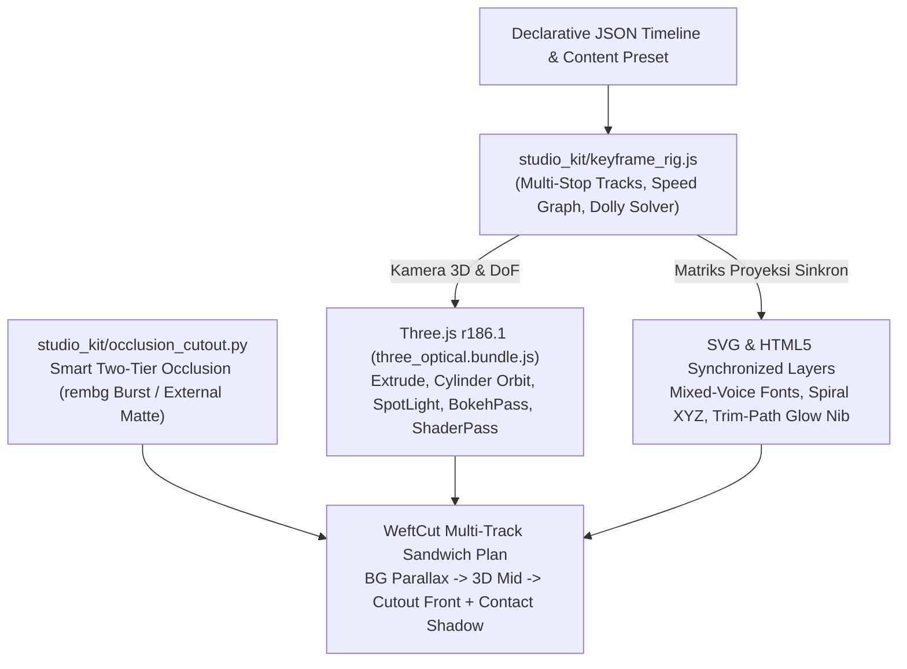

# Arsitektur Ruang 3D, Manipulasi Optik, Keyframe, dan Layer Sandwich

Dokumen ini merangkum hasil bedah lima video referensi gerak teks 3D dan optik serta menerjemahkannya ke dalam sistem lokal studio. Catatan ini disusun menggunakan register semiformal yang wajar tanpa kalibrasi suara pribadi penulis karena contoh tulisan pribadi belum tersedia.

Lima video referensi yang diperiksa adalah:
1. `ZcmcHeWWAuI`: DaVinci Fusion `Text+` -> `ImagePlane3D` -> `Merge3D` -> `Camera3D` (*Spline Ease In 85%*) + `LensBlur`.
2. `xCueXSWn-pk`: After Effects 3D layer per kata, background video didorong di sumbu Z, kamera `35mm`, speed graph ekstrem di awal (`Influence 17.58%`), serta keyframe `Focus Distance` + `Aperture` (`35-76 px`).
3. `tP8QuxWBliA`: After Effects Cinema 4D Renderer (`Extrusion Depth`), `Path Options` melingkar, `Spot Light` + `Ambient Light`, ekspresi rotasi `time * -50`, dan sandwich cutout subjek di atas teks 3D.
4. `gsS7uvyhYvI`: Objek 3D utama dengan pita teks `CC Cylinder` yang melingkari depan hingga belakang objek secara nyata.
5. `5kLbhiIc63w`: Animasi *trim path* huruf demi huruf disertai titik sumber cahaya (*glow nib*) yang menelusuri ujung garis secara *real time*.

---

## 1. Masalah Lama dan Akar Teknisnya

Sebelumnya, komposisi 3D kita hanya mengandalkan skala 2D datar pada sumbu X yang sama. Semua kata berhenti bersamaan pada kurva seragam tanpa kedalaman kamera atau *parallax* latar belakang. Akibatnya, huruf terasa menempel datar dan cepat membosankan.

Dengan arsitektur **Hybrid Declarative 4-Axis Rig**, masalah itu diselesaikan lewat empat lapisan terpadu:

---

## 2. Bedah Mekanika Optik, Keyframe, dan Layer Manipulation

| Aspek Teknis | Temuan Referensi Studi | Implementasi Lokal (`studio_kit/`) |
|---|---|---|
| **Speed Graph Kamera** | `xCueXSWn-pk` & `ZcmcHeWWAuI`: Ledakan kecepatan awal tajam lalu melambat panjang | Kurva `aeWhipOut` (`[0.12, 0.96, 0.18, 1.0]`) dan `aeWhipInOut` (`[0.78, 0, 0.18, 1]`) di [keyframe_rig.js](../../studio_kit/keyframe_rig.js) |
| **Kamera 35mm & DoF** | `xCueXSWn-pk`: `Focus Distance` dan `Aperture` berkeyframe seiring kamera mundur | `resolveCameraState` + `projectWorldToScreen` + `BokehPass` pada Three.js `r186.1` |
| **Penyebaran Ruang Z** | Kata tidak ditumpuk rata di Z=0; latar didorong ke Z negatif dan di-scale up | `buildSpiralWordLayout` membagi `(x, y, z, rotY, rotZ)` tiap kata secara otomatis |
| **3D Ekstrusi & SpotLight** | `tP8QuxWBliA` & `gsS7uvyhYvI`: Ekstrusi tebal, cahaya spot berwarna, pita silinder, bayangan jatuh | `TextGeometry` dari `.ttf` offline (`THREEX.parseTtfToFont`), `CylinderGeometry`, `SpotLight`, `ShadowMaterial` di Motif `cylinder-3d-orbit` |
| **Glow Nib Trim Path** | `5kLbhiIc63w`: Outline huruf tergambar progresif dengan titik cahaya mengikuti ujung path | `parseTtfOpenType` + `stroke-dashoffset` + `getPointAtLength` per glif pada Motif `signature-glow-trim` |
| **Layer Sandwich Oklusi** | `tP8QuxWBliA`: Subjek manusia di atas ring teks; ring teks di atas background | [occlusion_cutout.py](../../studio_kit/occlusion_cutout.py) + `toWeftCutLayerPlan` (`background -> 3D mid -> foreground cutout -> seam adjustment`) |

---

## 3. Alur Fleksibilitas Antar Jenis Konten (4-Axis Remix)

Setiap proyek masa depan tidak perlu memanggil satu template kaku. Sistem memisahkan **empat sumbu modular** pada `CONTENT_PRESETS` ([keyframe_rig.js](../../studio_kit/keyframe_rig.js)). Gaya visual pun bebas ditukar per adegan atau per ketukan musik:

1. **`talking_head_depth`**: Kamera `35mm` memakai *speed graph* `aeWhipOut` dan *background Z parallax* (`-2.4` dengan kompensasi skala `1.24x`) sehingga latar belakang bergerak pada kedalaman optik terpisah dari kata kunci yang menyebar spiral melalui `kinetic-3d-spatial`. Bagian *hook* awal 1 sampai 3 detik ditutup oleh *occlusion matte* CPU.
2. **`product_3d_orbit`**: Panggung utama memakai Three.js `r186.1` (`cylinder-3d-orbit`) lengkap dengan pantulan `RoomEnvironment`, `SpotLight` berwarna yang melempar bayangan ke bidang lantai, serta transisi *Pop-Up Anchor Scale* (`0% -> 105% -> 100%`) dari dasar objek.
3. **`mograph_editorial`**: Menggabungkan ruang 3D `Dolly Zoom` (`d * tan(FOV/2) = const`) dengan tipografi Mixed-Voice di mana adegan dibuka lewat `signature-glow-trim` beraksen bloom.
4. **`montage_flash_edit`**: Tempo berjalan agresif di `60 fps` lewat paduan `FlashCutoutStrobeShader` (*Tint/Invert*), `MotionTileWhipShader` (`Mirror Edges`), dan `rolling-cylinder-slot`.

---

## 4. Strategi Eksekusi di PC Lokal (Ryzen 5 5500 & GTX 1650)

* **Jalur GPU WebGL untuk Semua 3D & Shader**: `Three.js` dan Chrome Headless berjalan di GPU GTX 1650 lewat ANGLE D3D11 (`--use-gl=angle --use-angle=d3d11`). Seluruh modul `three@0.186.1` dan `opentype.js` sudah dibundel luring dalam `studio_kit/vendor/three_optical.bundle.js`. Tidak ada ketergantungan ke CDN luar.
* **Dua Tingkat Cutout (`Smart Two-Tier Occlusion`)**: Karena PyTorch Python masih memakai CPU, `occlusion_cutout.py` memakai `rembg` secara instan untuk *Pop-Up 1-frame*, *Flash Cutout 8-12 frame*, dan *Hook 1-3 detik*. Untuk orbit panjang di belakang subjek bergerak, sistem memakai slot `alphaMatteSource` eksternal agar proses render tetap cepat.
* **Normalisasi Durasi Otomatis (*Time-Remapping*)**: Properti keyframe boleh ditulis dengan rasio `u` (`0.0` hingga `1.0`). Saat durasi klip berubah, kurva kecepatan ikut menyesuaikan secara otomatis. Kita tidak perlu menggeser angka frame satu per satu.
