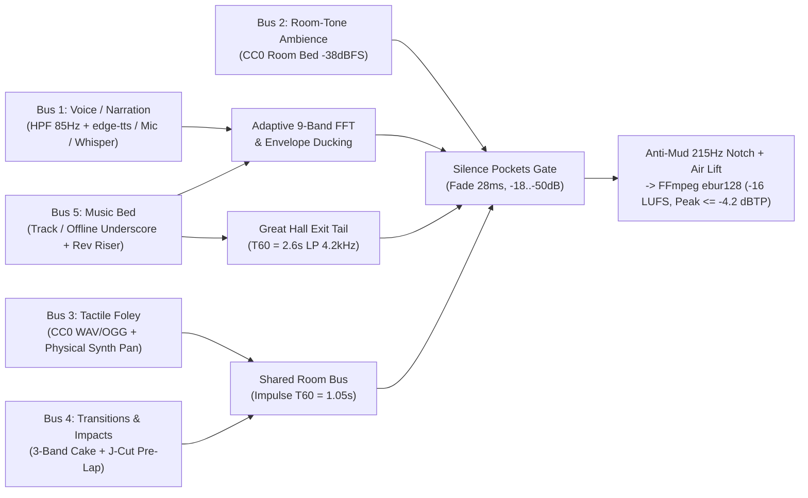

# Arsitektur Tata Suara, Ritme Naratif, dan Ekonomi B-Roll Studio v3

Dokumen ini merangkum arsitektur audio, ritme penceritaan, dan standar ekonomi visual (*zero waste*) untuk AGY Local Video Studio tanpa layanan awan berbayar. Seluruh rancang bangun ditarik dari analisis spektral, pembacaan dinamika `ebur128`, dan transkrip `faster-whisper` pada tujuh video rujukan. Audit atas hasil render versi sebelumnya juga ikut dijadikan pijakan teknis. Pada panduan ini tidak dilakukan kalibrasi suara pribadi pengguna, sehingga prosanya ditulis memakai laras teknis netral (*semiformal*).

---

## 1. Diagnosis Akar Masalah Mix Studio Sebelumnya

Pengukuran terhadap `studio_kit/renders/showcase_v2_depth_optics.mp4` yang berdurasi 9,0 detik menyingkap penyebab utama audionya terdengar mendem. Nilai loudness terintegrasinya memang tercatat di `-14,3 LUFS` dengan True Peak `-4,5 dBFS`. Akan tetapi sebaran spektrumnya berat sebelah karena sebanyak `42,67%` daya berkumpul di pita lumpur `100-350 Hz`, sementara pita rendah `20-90 Hz` turut menyerap `32,26%` daya hingga hampir tiga perempat energi terjebak di bawah `350 Hz`. Sebaliknya, pita kejernihan `2.500-8.000 Hz` tersisa `0,42%` dan pita udara `8.000-18.000 Hz` tinggal `0,07%`. Pita atasnya nyaris mati total.

Kondisi itu bertolak belakang dengan acuan OneTake pada berkas `.agents/skills/onetake/cases/unbroken-15s/unbroken.mp4`. Dalam acuan itu pita lumpur bertahan di `22,1%`, porsi mid vokal mengisi `59,38%`, sedangkan gabungan detail bersama udara mencapai `12,53%`. Lemahnya spektrum atas di versi sebelumnya turut diperparah lubang senyap digital antarketukan. Sekitar `61,2%` durasi interiornya turun di bawah `-68 dBFS` karena tidak ada lapisan *room-tone*, sementara transisi hanya memakai gelombang sinus `55 Hz` tanpa tekstur gerak. Bunyi seperti itu terdengar sebagai sinyal terpisah.

---

## 2. Pelajaran Terukur dari Tujuh Video Rujukan

| Rujukan | Durasi / LUFS / LRA | Karakter Spektral & Dinamika | Prinsip Kunci yang Diambil ke Studio |
|---|---|---|---|
| `Herman Huang` (`tzfzkTAQsnE`) | `441,7s`, `-14,5 LUFS`, `LRA 3,9`, `152` cuts (`CV 0,97`) | `mud 33,59%`, `voice 29,27%`, `quiet15 5,3%` | Tiga lapis spektrum suara (*cake layering*), ukiran pita vokal dinamis pada musik, konsistensi palet suara, *Emotional Realism*, serta ekor reverb *Great Hall* saat musik keluar |
| `DJI / @PeaceGates` (`UYq0o9Klf8I`) | `17,1s`, `-14,3 LUFS`, `LRA 3,7`, `8` cuts (`CV 0,85`) | `voice 46,82%`, `detail+air 8,48%`, `quiet15 11,4%`, drop `-60 dBFS` di `t=6,9s` | Pembuktian langsung A/B suara mati lawan suara penuh, *micro-silence drop* tepat sebelum kata penekanan (`OFF`), B-roll singkat untuk membuktikan argumen, dan putaran akhir tanpa jahitan |
| `Graded by Oscar` (`6V8zYYzxPCA`) | `27,8s`, `-21,8 LUFS`, `LRA 9,1` (paling dinamis) | `quiet15 7,2%`, lintasan `ambience` menembus banyak potongan | Trek *ambience* (eskalator dan kereta bawah tanah) berjalan terus melampaui batas potongan gambar, disertai *J-cut* bunyi langkah mendahului shot sepatu di detik `5,55` |
| `Kristian Ruvino` (`MlaidhI2034`) | `8,8s`, `-9,9 LUFS`, `LRA 4,0` | `sub 48,18%`, `sil48 3,1%`, tumpukan foley mekanis rapat | Pemilihan lagu mendahului pemotongan visual agar tempo selaras dengan suasana, lalu foley mekanis mikro dikunci tepat pada titik transien gerakan |
| `Gaku Lange` (`PLZRzKMxsqE`) | `24,1s`, `-13,6 LUFS`, `LRA 2,8`, `CV 0,94` | Tumpukan `2-3` impact di hook, riser bertemu whoosh di `4-5s` | Struktur makro tiga babak (*hook*, *transition*, *ending loop*) serta pembalikan ekor *riser* menjadi *impact* penutup |
| `Rourke` (`YKGhX9Dxycg`) | `44,2s`, `-15,2 LUFS`, `LRA 2,9`, `CV 0,53` | Pemisahan bersih track `ambience`, `vehicles`, `foley`, `impacts`, `sub` | Diambil struktur klasifikasi lima peran trek suaranya secara lokal tanpa memakai generator video atau pustaka awan berbayar |
| `Andrew` (`pdLEHfkwgV8`) | `314,0s`, `-14,5 LUFS`, `LRA 5,3`, `CV 1,62` | `voice 43,65%`, `mud 44,67%`, `detail+air 3,53%`, `quiet15 7,4%` | Pembuka tunjuk langsung (*Show First*), papan potong hijau bersama kartu kertas *CLIP 1-3*, lencana gelombang stereo NLE muncul persis saat foley berbunyi, serta panah penurunan lagu saat transisi masuk |

Pengukuran spektral pada video `Andrew` (`pdLEHfkwgV8`) mengoreksi standar audit awal studio. Suara narator jarak dekat membawa energi dada hangat di rentang `120-350 Hz` (`44,67%`), sementara energi mid vokal tetap kuat di `43,65%`. Profil `narrative_voice_film` dan `mograph_sfx` di `studio_kit/acoustic_audit.py` pun dipisah. Dialog natural tidak lagi terbaca sebagai lumpur. Sebaliknya, materi padat SFX tanpa vokal tetap dijaga ketat di bawah `35,0%`. Rujukan ini ikut membuktikan satu hal penting: potongan gambar nyata, kartu kertas, dan bilah gelombang NLE jauh lebih komunikatif dibanding objek 3D abstrak atau kisi neon gelap.

---

## 3. Arsitektur 5-Stem & Signal Flow Lokal

Agar efek suara tidak lagi terdengar seperti tempelan terpisah di Ryzen 5 5500, seluruh pemrosesan dijalankan oleh `studio_kit/sound_engine.py` pada laju `48 kHz` stereo. Lima bus utama dikelola terpisah sebelum bertemu di ruang akustik bersama untuk tahap akhir. Suara bicara pun tetap jernih.

### 3.1 Tumpukan Spektrum Tiga Lapis (*Audio Spectrum Cake*)

Saat transisi besar atau kemunculan elemen utama diberi tanda `intensity = "hero"`, pemakaian satu berkas *whoosh* sendirian langsung ditolak sistem. Fungsi `add_layered_transition` otomatis memecah sinyal ke dalam tiga rentang agar bunyinya terasa penuh tanpa menumpuk di pita `100-350 Hz`. Tiap jalur memiliki batas frekuensi masing-masing.

1. Lapisan **Low Anchor (`sub_low`, LP 155 Hz)**: memakai aset `sub_low` atau bentukan fisik `sub()` berdurasi singkat. Pita ini menambah bobot bawah tanpa membebani suara manusia.
2. Lapisan **Mid Body (`mid_body`, BP 260-2.800 Hz)**: membentuk karakter gesekan kayu, kain, maupun perpindahan kamera. Klip ini biasanya masuk lebih awal `50-240 ms` mendahului potongan visual (*J-cut pre-lap*).
3. Lapisan **High Air (`high_air`, HP 2.600 Hz)**: menyuplai desir udara atas atau kilau logam halus. Pita tinggi ini menolong transisi tetap terbaca di pelantang ponsel.

### 3.2 Ukiran Vokal Dinamis & Transisi Musik Tanpa Rem Mendadak

Begitu jalur pembicara aktif, fungsi `carve_bed_under_voice` menjalankan algoritma ukiran adaptif dari `.agents/skills/media-use/audio/scripts/lib/audio-carve.mjs` pada Python bersama SciPy, yang memindai tujuh pita sepertiga oktaf antara `250 Hz` hingga `4.000 Hz` guna melacak di mana vokal paling banyak bertumbukan dengan musik latar. Filter takik dinamis langsung bekerja begitu suara muncul, lalu melepas halus selama `320 ms` saat jeda tiba. Dialog pun terdengar bersih.

Musik yang berakhir mendadak turut ditangani dua jalur otomatis. Menjelang jeda hening atau akhir adegan, potongan ketukan terakhir dikirim menuju impuls konvolusi *Great Hall* (`T60 = 2,6 detik` yang disaring pada `4.200 Hz`), sedangkan bagian keringnya meredup dalam `180 ms`. Jika video dirancang berputar ulang (*loop*), `make_reversed_riser` membalik awal musik agar naik menuju frame `0.000`. Putaran terasa mulus.

### 3.3 Bank Aset Lokal Terindeks & Palet Koheren

Skrip `studio_kit/build_sound_index.py` memindai seluruh `149` berkas audio luring bebas royalti yang tersimpan di workspace ini (`103` berkas CC0 `.ogg` pada `sound-effects/sfx/`, `19` berkas `.mp3` Pixabay pada `media-use/audio/assets/sfx/`, dan `27` berkas `.wav` CC0 di `ghost-editor/library/sfx/`) lalu mencatat *spectral centroid* beserta distribusi lima pitanya ke `studio_kit/sound_palette_index.json`.

Untuk menjaga keselarasan rasa, satu proyek wajib mengunci satu palet dari daftar `editorial-clean`, `kinetic-street`, `organic-cinema`, `comedic-dry`, atau `gaming-montage`. Aturan itu mencegah lonceng lembut bercampur bersama glitch kasar. Pengecualian tetap terbuka lewat catatan *Emotional Realism*, yakni saat suara alam atau mekanis sengaja dipakai untuk menguatkan sisi batin gambar.

---

## 4. Kontrak Narasi, Ekonomi B-Roll, dan Gerbang Audit Kualitas

Kebiasaan menempel gambar sisipan atau efek *whoosh* tanpa arah dihalau lewat dua gerbang sebelum dan sesudah render. Gerbang awal memeriksa rancangan sebelum peramban terbuka, sedangkan gerbang akhir mengaudit berkas keluaran.

1. **Gerbang Pra-Render (`studio_kit/beat_sheet.py`)**: setiap video wajib memiliki berkas `beat_sheet.json` sebelum gambar diproses peramban. Berkas ini mencatat subjek visual konkret (`visual_subject`), tujuan tiap potongan (`narrative_purpose`), serta alasan gambar sisipan (`broll_justification`). Tiap isyarat suara juga wajib menyertakan penyebab visual (`visual_cause`) atau aturan kontras (`contrast_rule`). Istilah hampa seperti prisma abstrak atau oktahedron gelap langsung ditolak. Selain itu, variasi durasi shot wajib memenuhi `shot_cv >= 0,20` dengan minimal satu kantong hening `silence_pockets` pada durasi `8,0` detik ke atas.
2. **Gerbang Pasca-Render (`studio_kit/acoustic_audit.py`)**: berkas MP4 atau WAV akhir diaudit memakai `FFmpeg ebur128` serta analisis FFT lima pita sesuai profil proyeknya (`narrative_voice_film` atau `mograph_sfx`). Loudness terintegrasi harus berada antara `-18,5` hingga `-13,0 LUFS`. Puncak sejati paling tinggi `-3,5 dBFS` dengan rentang dinamika minimal `2,4 LU`. Pada `narrative_voice_film`, batas lumpur `100-350 Hz` diizinkan hingga `48,0%` selama pita vokal minimal `18,0%` dan detail atas minimal `2,5%`. Pada `mograph_sfx`, batas lumpur dijaga di bawah `35,0%` dengan detail minimal `4,0%`. Di luar jendela `silence_pockets`, kekosongan digital di bawah `-68 dBFS` maksimal `35%`, disertai penurunan suara minimal `8,0 dB` pada tiap kantong hening. Mix mentah gagal otomatis di sini.

---

## 5. Integrasi ke WeftCut MCP & Spesifikasi Workstation Target

Selain menghasilkan berkas `master_mix.wav`, fungsi `sound_engine.py` turut mengekspor lima saluran terpisah di folder `stems/` (`stem_voice.wav`, `stem_ambience.wav`, `stem_foley.wav`, `stem_transitions.wav`, `stem_music.wav`) bersama berkas `weftcut_stem_plan.json`. Alur ini memudahkan penyuntingan lanjutan di **WeftCut** lewat protokol MCP karena tiap peran audio langsung masuk ke jalur treknya. Seluruh konvolusi *fftconvolve*, FFT sembilan pita, transkrip `faster-whisper` (`int8`), hingga render Playwright `ANGLE D3D11` berjalan penuh di **AMD Ryzen 5 5500, RAM 16 GB, GTX 1650 (4 GB VRAM)** secara luring di drive `D:`.
